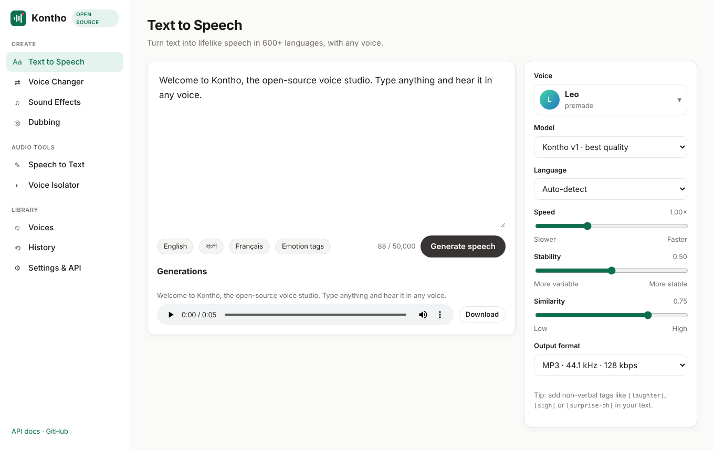
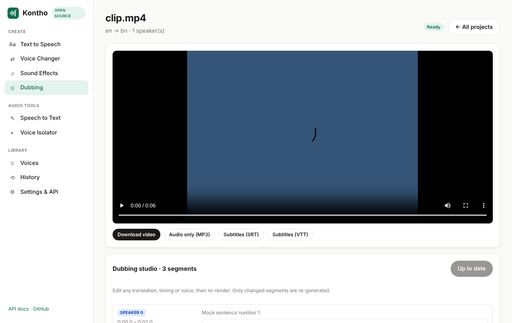
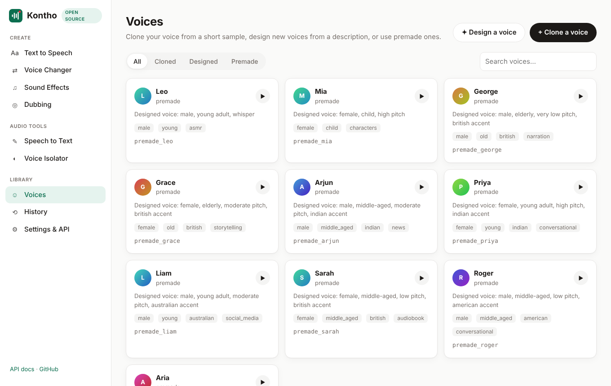

<p align="center">
  
</p>
<h1 align="center">Kontho</h1>
<p align="center"><b>কণ্ঠ · "voice"</b>: an open-source, self-hosted voice AI studio.<br/>
Text-to-speech, voice cloning, voice design, speech-to-text, voice changer, sound effects, voice isolation and AI dubbing,<br/>
with a web studio and an <b>ElevenLabs-compatible API</b>.</p>

<p align="center">
  <a href="LICENSE"></a>
  
  
</p>



Kontho runs entirely on your own machine or server. Your voices, audio and data never leave it, there is no per-character
pricing, and every model is open. Point an existing ElevenLabs integration (official SDKs included) at your Kontho server and it keeps working.

## Features

| | Feature | What you get | Engine (default) |
|---|---|---|---|
| 🗣️ | **Text to Speech** | 600+ languages including **Bengali**, French, Hindi, Arabic and Chinese; long texts (50k chars); streaming; character timestamps; speed / stability / similarity controls; MP3, WAV, PCM, Opus, FLAC, μ-law output; non-verbal tags such as `[laughter]` and `[sigh]` | [OmniVoice](https://github.com/k2-fsa/OmniVoice) |
| 🧬 | **Instant Voice Cloning** | Clone any voice from 3–30 s of audio (upload or record in the browser), with optional background-noise removal and automatic transcription of the reference | OmniVoice |
| 🎭 | **Emotion tags** | Write `[angry]`, `[sad]`, `[whisper]`, `[surprised]`… (17 emotions, 85+ aliases; ElevenLabs-style tags like `[shouting, urgent]` work as-is). Each voice holds one clip per emotion, and missing emotions fall back to a related one. Import whole emotion packs from a .zip | OmniVoice (emotion-aware cloning) |
| ✨ | **Voice Design** | Create a new voice from attributes (gender, age, pitch, accent, whisper), get 3 previews, keep the one you like | OmniVoice |
| 📚 | **Voice Library** | 10 premade voices, plus your cloned and designed voices, searchable, with labels, previews and editing | |
| ✍️ | **Speech to Text** | 99 languages, word-level timestamps, speaker diarization, export to TXT / SRT / VTT / JSON | [faster-whisper](https://github.com/SYSTRAN/faster-whisper) (+ [pyannote](https://github.com/pyannote/pyannote-audio)) |
| 🔁 | **Voice Changer** (speech-to-speech) | Re-speak a recording in another voice, keeping the words and the timing; optionally keep the background | Whisper + OmniVoice |
| 🔊 | **Sound Effects** | Text-to-SFX: foley, ambience, transitions (0.5–30 s) | [AudioLDM 2](https://huggingface.co/cvssp/audioldm2) or [Stable Audio Open](https://huggingface.co/stabilityai/stable-audio-open-1.0) |
| 🎚️ | **Voice Isolator** | Separate speech from music and noise, and download both stems | [Demucs](https://github.com/facebookresearch/demucs) |
| 🌍 | **AI Dubbing** | Video or audio in, translated video out: isolates the background, transcribes and separates speakers, translates, **clones each original speaker**, fits every line to its original timing, remixes and muxes the video, plus subtitles | All of the above + [NLLB-200](https://huggingface.co/facebook/nllb-200-distilled-600M) or any LLM |
| 🎬 | **Dubbing Studio** | Edit any segment's translation, timing or voice; re-translate one line; re-render only what changed | |
| 🕘 | **History** | Every generation stored and re-downloadable in any format | |
| 🔑 | **API & keys** | ElevenLabs-compatible REST API, API keys, OpenAPI docs at `/docs` | |
| 📖 | **Pronunciation dictionary** | Global word replacements applied before synthesis (acronyms, names) | |

<p align="center"> </p>

## Quick start

### Docker (recommended)

```bash
git clone https://github.com/<you>/kontho.git && cd kontho
cp .env.example .env
docker compose up -d                           # CPU
# or, with an NVIDIA GPU (nvidia-container-toolkit installed):
docker compose --profile gpu up -d kontho-gpu
```

Open **http://localhost:8000**. Models download on first use and are cached in the `kontho-models` volume
(about 3 GB for TTS, 1.6 GB for Whisper large-v3-turbo, 2.5 GB for NLLB and 3 GB for AudioLDM2).
Run `docker compose exec kontho kontho download` to fetch them all up front.

### Local install

Requires Python 3.10+, `ffmpeg` and (for the web studio) Node 18+.

```bash
./scripts/install.sh            # CPU / Apple Silicon
./scripts/install.sh --cuda     # NVIDIA GPU
. .venv/bin/activate && kontho serve
```

### Try the UI without downloading any model

Every engine has a `mock` implementation that produces placeholder tones. It's useful for UI work and CI:

```bash
pip install -e server
KONTHO_TTS_ENGINE=mock KONTHO_STT_ENGINE=mock KONTHO_SFX_ENGINE=mock \
KONTHO_ISOLATION_ENGINE=mock KONTHO_TRANSLATE_ENGINE=mock kontho serve
cd web && npm install && npm run dev      # http://localhost:5173 (proxies the API on :8000)
```

### Hardware

| Setup | Experience |
|---|---|
| NVIDIA GPU, 8 GB+ VRAM | Recommended. Faster than real time for TTS, and a few minutes for a 5-minute dub |
| Apple Silicon (MPS) | Works; slower than CUDA |
| CPU only (4+ cores, 16 GB RAM) | Works for everything; TTS takes roughly 5–15 s of compute per second of audio. Use the `kontho_turbo` model and Whisper `small` |

## Use the API (ElevenLabs-compatible)

```bash
curl -X POST "http://localhost:8000/v1/text-to-speech/premade_aria?output_format=mp3_44100_128" \
  -H "Content-Type: application/json" \
  -d '{"text": "আমার সোনার বাংলা, আমি তোমায় ভালোবাসি।", "model_id": "kontho_v1", "language_code": "bn"}' \
  --output speech.mp3
```

**Official ElevenLabs SDKs work unchanged.** Only the base URL changes:

```python
from elevenlabs.client import ElevenLabs

client = ElevenLabs(api_key="kt_...", base_url="http://localhost:8000")
audio = client.text_to_speech.convert(voice_id="premade_aria", text="Hello!", model_id="kontho_v1")
```

```js
import { ElevenLabsClient } from "@elevenlabs/elevenlabs-js";
const client = new ElevenLabsClient({ apiKey: "kt_...", baseUrl: "http://localhost:8000" });
```

The full endpoint list is in [docs/API.md](docs/API.md), and interactive docs are at `http://localhost:8000/docs`.

Model ids: `kontho_v1` (quality) and `kontho_turbo` (about 2× faster). ElevenLabs ids are accepted too: `eleven_flash_*` and `eleven_turbo_*` map to turbo, everything else to v1.

## Emotions

The voice model copies **timbre, accent and emotion** from its reference clip. So instead of guessing emotions
from words, Kontho stores a reference clip per emotion for each voice and switches between them as it reads the tags:

```text
[calm] সেদিন সকালটা ছিল অন্য দিনের মতোই শান্ত। [tense] কিন্তু দুপুর গড়াতেই আকাশ কালো হয়ে এলো।
[shouting] ভয় পাইয়েন না! আমি আইতাছি! [calm] সব ঠিক হইয়া যাইব।
```

- **Emotions:** neutral, calm, warm, happy, excited, sad, crying, worried, tense, scared, angry, shouting, surprised, mysterious, pleading, laughing, whisper. Aliases include annoyed→angry, sobbing→crying, panicked→scared and hopeful→happy (`GET /v1/emotions` lists them all).
- **Tag rules:** a tag applies until the next one, and `[neutral]` returns to the normal voice. In multi-word tags the last recognised emotion wins. `[pause]` becomes a pause, and sound tags (`[laughter]`, `[sigh]`…) are kept.
- **Fallbacks:** a voice with no `shouting` clip uses `angry`, then `scared`, then its normal voice. The response header `emotions-used` shows what was used, e.g. `shouting=angry,crying=sad`.
- **Adding clips:** in the studio (Voices → Edit → Emotions), or with `POST /v1/voices/{id}/emotions`. A whole cast at once: a zip of `voice_emotion.mp3` files + `transcripts.txt` via **Import emotion pack** (`POST /v1/voices/import-pack`). Good sources are your own recordings, or lines from a TTS service you already paid for.
- Use 5–10 s of clean speech per clip, clearly in that emotion, from the same speaker. Clone only voices you have permission to use.

## Configuration

All settings are environment variables. See [`.env.example`](.env.example). The most important ones:

| Variable | Default | |
|---|---|---|
| `KONTHO_TTS_ENGINE` / `STT` / `ISOLATION` / `TRANSLATE` / `SFX` | `omnivoice` / `whisper` / `demucs` / `nllb` / `audioldm2` | Engine per capability (`mock` everywhere for no models) |
| `KONTHO_DEVICE` | `auto` | `cuda`, `cpu` or `mps` |
| `KONTHO_WHISPER_MODEL` | `large-v3-turbo` | Any faster-whisper size |
| `KONTHO_TRANSLATE_ENGINE=llm` + `KONTHO_LLM_*` | Ollama on `localhost:11434` | Context-aware dubbing translation with any OpenAI-compatible LLM |
| `HF_TOKEN` | | Needed for speaker diarization (pyannote) and Stable Audio Open (gated models) |
| `KONTHO_AUTH` / `KONTHO_ADMIN_KEY` | `false` | Require an `xi-api-key` on every request. **Turn this on before exposing the server to the internet.** |
| `KONTHO_DATA_DIR` | `./data` | SQLite database and all audio files |

## Model licenses

Kontho's code is Apache-2.0. **The model weights have their own licenses. Check them before commercial use:**

| Model | License | Commercial use |
|---|---|---|
| OmniVoice (TTS, cloning, design) | Apache-2.0 | ✅ |
| Whisper / faster-whisper (STT) | MIT | ✅ |
| Demucs (isolation) | MIT | ✅ |
| pyannote speaker-diarization-3.1 | MIT (gated: accept the terms on Hugging Face) | ✅ |
| NLLB-200 (translation) | CC-BY-NC-4.0 | ❌ Use `KONTHO_TRANSLATE_ENGINE=llm` with a permissively licensed LLM instead |
| AudioLDM 2 (SFX) | CC-BY-NC-SA-4.0 | ❌ |
| Stable Audio Open 1.0 (SFX) | Stability AI Community License | ✅ under the license's revenue threshold |

## Architecture

```
web/ (React + Vite)  ──►  server/kontho (FastAPI)
                           ├── api/routes.py        ElevenLabs-compatible REST API
                           ├── services/            tts · voices · stt · changer · sfx · dubbing
                           ├── engines/             pluggable AI backends (+ mock engines)
                           │     omnivoice_tts · whisper_stt · demucs_isolation · diffusers_sfx · translate
                           ├── jobs.py              background queue for long jobs (dubbing)
                           ├── db.py                SQLite (voices, history, jobs, keys, pronunciation)
                           └── audio.py             ffmpeg/numpy audio toolkit (formats, stretch, mix, mux)
```

### Adding an engine

Implement one of the interfaces in [`engines/base.py`](server/kontho/engines/base.py) (`TTSEngine`, `STTEngine`,
`SFXEngine`, `IsolationEngine`, `TranslateEngine`), register it, and select it with an environment variable:

```python
from kontho.engines import register
register("tts", "my-engine", "my_package.module:MyTTS")   # then KONTHO_TTS_ENGINE=my-engine
```

Good candidates: Chatterbox, F5-TTS, Kokoro (fast preset voices), Seed-VC (true voice conversion), WhisperX.

## Roadmap

Kontho v0.1 covers ElevenLabs' core voice suite and dubbing. Planned next:

- [ ] **Conversational AI agents**: real-time STT → LLM → TTS over WebSocket, with an embeddable widget
- [ ] **Studio / audiobooks**: long-form projects with chapters, per-paragraph voices and EPUB/PDF import
- [ ] WebSocket streaming TTS (`/v1/text-to-speech/{id}/stream-input`)
- [ ] Native voice conversion (Seed-VC / OpenVoice) as an alternative voice-changer engine
- [ ] Professional voice cloning (fine-tuning on 30+ minutes of audio)
- [ ] Music generation, lip-sync for dubbed video, multi-language dubs per project
- [ ] Multi-user accounts, quotas and usage analytics

Contributions are very welcome. See [CONTRIBUTING.md](CONTRIBUTING.md).

## Responsible use

Voice cloning is powerful. Only clone voices you own or have **explicit permission** to use. Never use Kontho to
impersonate people, commit fraud, or create deceptive content. The clone dialog asks for this confirmation, and
operators of public instances should enable API keys and keep logs.

## License

[Apache-2.0](LICENSE). Kontho is an independent project and is not affiliated with ElevenLabs.
"ElevenLabs-compatible" refers only to the shape of the HTTP API.
